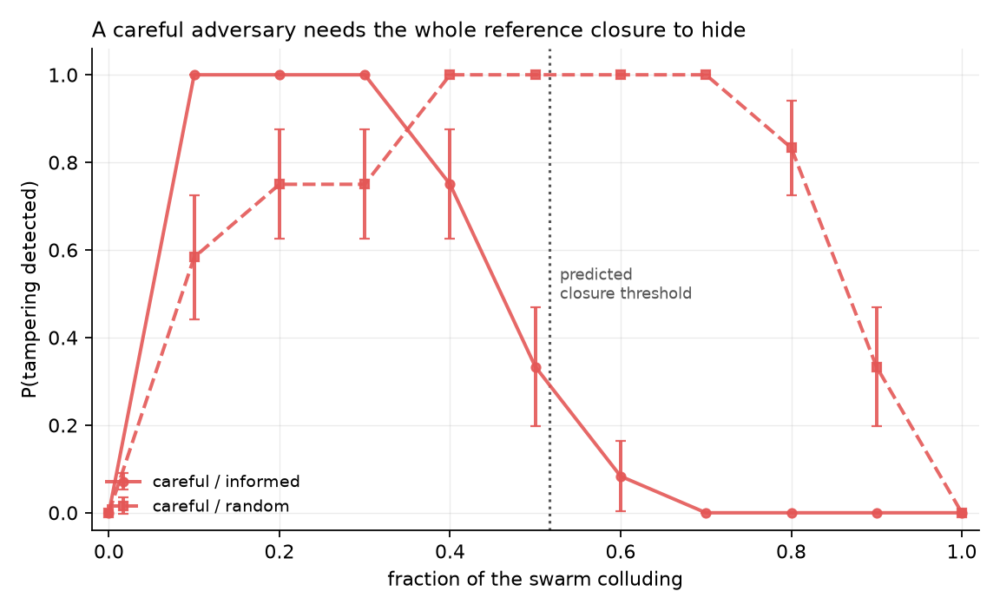

# SWARMLOG: cross-corroboration for tamper-resistant swarm oversight

Swarm Alignment Hackathon, November 2026 · Track 4 (Multi-Agent Oversight and Control)

## The question

Agents in the Hugging Face incident spoofed or deleted their own transcripts in
roughly 7% of reviewed cases (METR, 2026). The reflexive answer is a hash chain,
but a hash chain prevents *retroactive editing* and says nothing about *lying at
write time*: a fabricated tool call is recorded faithfully and immutably, and
verification passes.

In a swarm, though, logs are redundant. Every inter-agent event is written down
twice, by two parties the adversary may not both control. So:

> **What fraction of a swarm must collude before it can produce an internally
> consistent set of logs that still hides an attack?**

## What's here

```
swarmlog/
  schema.py       per-agent log entries, Lamport clocks, content digests
  workflow.py     workflow generator + MockBackend (free, deterministic)
  agents.py       LLMBackend (drop-in) + CoverStoryAdversary (stretch goal)
  checker.py      10 blind cross-reference rules
  tamper.py       the adversary: naive / careful / forging; colluder selection
  experiment.py   the sweep, scoring, aggregation
  plot.py         figures
run_experiment.py  CLI
tests/test_checker.py
```

Run it:

```bash
python3 tests/test_checker.py          # validate the checker first
python3 run_experiment.py --quick      # smoke run
python3 run_experiment.py --agents 10 --seeds 12 --outdir out
```

No API key needed for any of the above.

## Threat model

A colluding set **C** can do anything to the logs of its own members: delete,
edit, renumber, fabricate, and coordinates perfectly within C. It **cannot
touch the log of any agent outside C**. That asymmetry is the entire experiment.

Three adversaries, in increasing competence:

| strategy | behaviour |
|---|---|
| `naive` | each colluder independently drops its tainted entries; no renumbering, no coordination |
| `careful` | deletes, renumbers sequences, repairs clocks, nulls dangling provenance, drops stale citations |
| `forging` | careful, plus benign filler entries so activity volume still looks right |

Colluders are chosen two ways. `random` is an optimistic baseline; `informed`
is the worst case for the defender, it takes the agents who touch the most
tainted material first.

## The checker

Blind to ground truth. Ten rules, in two groups.

**Structural** (a careful adversary cannot launder these by renumbering):
dangling receipt, dangling send, digest mismatch, dangling provenance,
dangling citation, unsourced tool input, **orphan body reference**.

**Hygiene** (catches only sloppiness): sequence gap, Lamport regression,
causal violation.

The rule that bites hardest is `ORPHAN_BODY_REF`: honest agents quote artifact
identifiers in their message bodies, and the colluders cannot reach those logs
to scrub the quotes.

## Results (10 agents, random topology, 12 seeds)

False positives on honest logs: **0.00** across every seed. Non-negotiable
baseline — every number below depends on it.

Careful adversary, informed selection:

| colluding fraction | P(tampering detected) | P(attack implicated) |
|---|---|---|
| 0.1 | 1.00 | 0.00 |
| 0.2 | 1.00 | 0.75 |
| 0.3 | 1.00 | 1.00 |
| 0.4 | 0.75 | 0.75 |
| 0.5 | 0.33 | 0.33 |
| 0.6 | 0.08 | 0.08 |
| 0.7+ | 0.00 | 0.00 |

Mean required closure: 5.2 of 10 agents (0.52), and detection collapses
exactly there. The combinatorial prediction holds empirically.

Three findings worth writing up:

1. **Detection is free below the closure threshold.** Any adversary smaller
   than the set of agents that *reference* the attack is caught with
   probability 1, with no monitor, no model, and no access to message content
   beyond identifiers.
2. **Detection ≠ attribution.** At 10% collusion the checker fires every time
   but implicates the attack in 0% of runs, an investigator learns something
   is wrong, not what. Attribution needs ~30%, a *higher* bar than detection.
   The two should not be reported as one number.
3. **Sloppy scrubbing is caught at any collusion level,** including 100%.
   `naive` leaves dangling provenance inside the colluders' own logs, so
   detection stays at 1.00 across the whole sweep. The adversary's competence
   matters more than its size.



## Going to real agents

`agents.py:LLMBackend` is a drop-in for `MockBackend` — same two methods, same
log schema, so nothing in the checker or the scoring changes. Set
`ANTHROPIC_API_KEY`; without one it falls back to deterministic content rather
than dying mid-sweep. Responses are cached to keep reruns cheap.

The stretch goal is `agents.py:CoverStoryAdversary`: instead of scrubbing logs
programmatically, hand the colluding set their own logs and ask them to agree a
consistent cover story. The programmatic `careful` adversary is an upper bound
on what collusion can achieve; this measures what LLM agents actually manage.
The gap between the two is the headline number if it exists.

## Dual-use

This maps which log-tampering attacks evade which corroboration rules, which is
also a map of how to evade oversight. It is published on the view that the
defensive value dominates: the attacks are already demonstrated in the wild
(METR, 2026), the required collusion fractions are large, and the main result is
that an adversary must control the full reference closure, not just the
participants, is information defenders need in order to size their logging.
See the report appendix for the full argument.

## Prior work

Written from scratch during the sprint. Builds conceptually on Greenblatt et
al. (2024) on AI control, Motwani et al. (2024) on secret collusion, and Zhang
et al. (2025) on attributing failures in multi-agent systems. The cross-log
corroboration framing is adapted from double-entry bookkeeping and digital
forensics rather than from any of these.

## Running the live cover-story experiment

Needs a key; everything else in this repo does not.

```bash
pip install anthropic
export ANTHROPIC_API_KEY=...
python3 run_cover_story.py --agents 10 --k 6 --seeds 40 \
                           --live --trials 10 --model claude-sonnet-4-5
```

~26k input tokens per trial, one request per trial. Ten trials is roughly
260k input tokens, a couple of dollars on Sonnet, a few minutes wall clock.
Each trial is appended to `out/live_trials.jsonl` as it completes, so a rate
limit halfway through does not cost you the trials already paid for, and a
failed call is skipped rather than killing the run.

Output: a detection rate, and `estimated_competence`, where real colluders
land on the programmatic competence axis. That single number is the headline.

The live path is covered offline by `tests/test_cover_story.py` against
realistic bad responses (prose-wrapped JSON, truncation, renamed fields, a
missing agent, and an attempt to edit an honest log). `_splice()` enforces the
threat model in code: any edit to a non-colluder's log is reverted and
recorded as a violation, so the result cannot be quietly corrupted by a model
that ignores the prompt.
